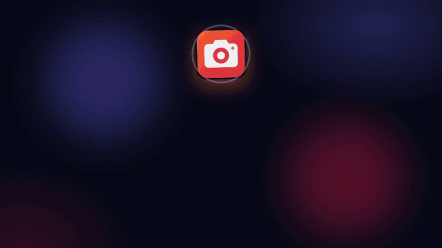
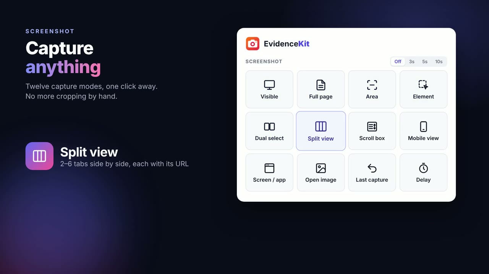
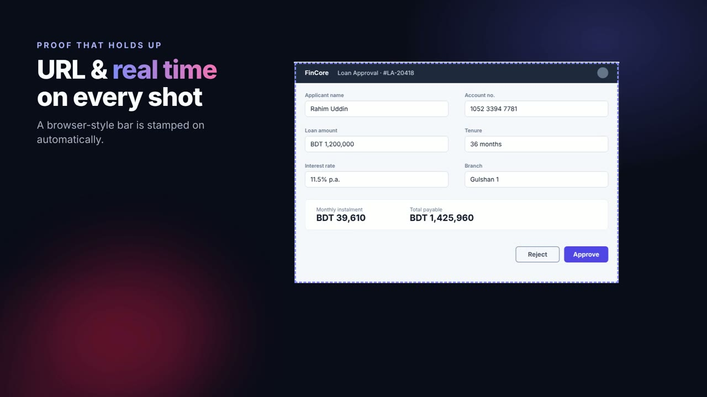
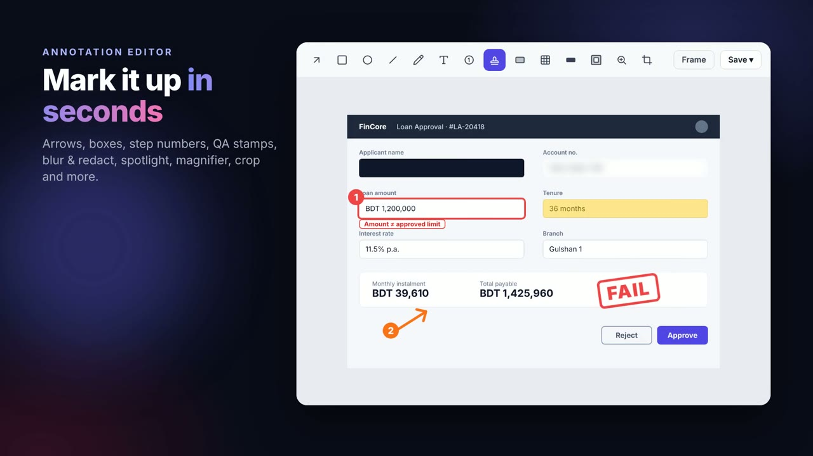
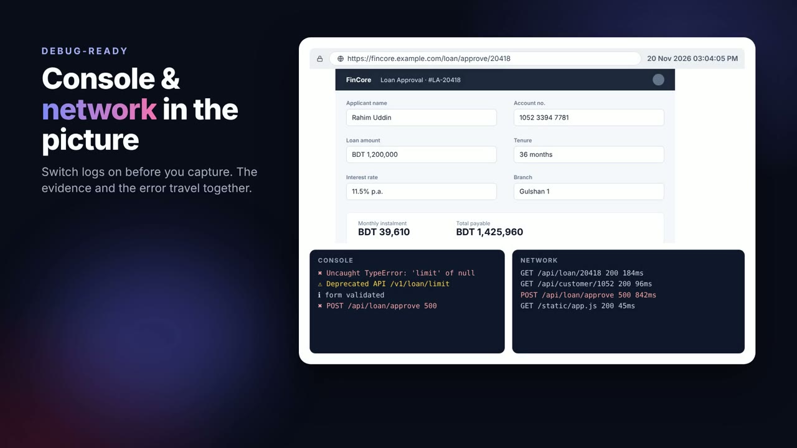
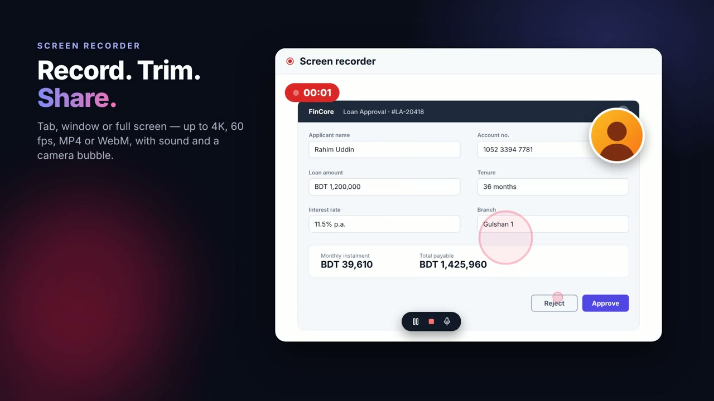
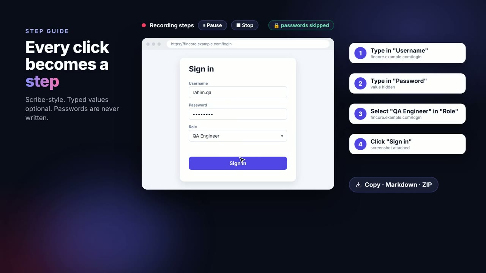
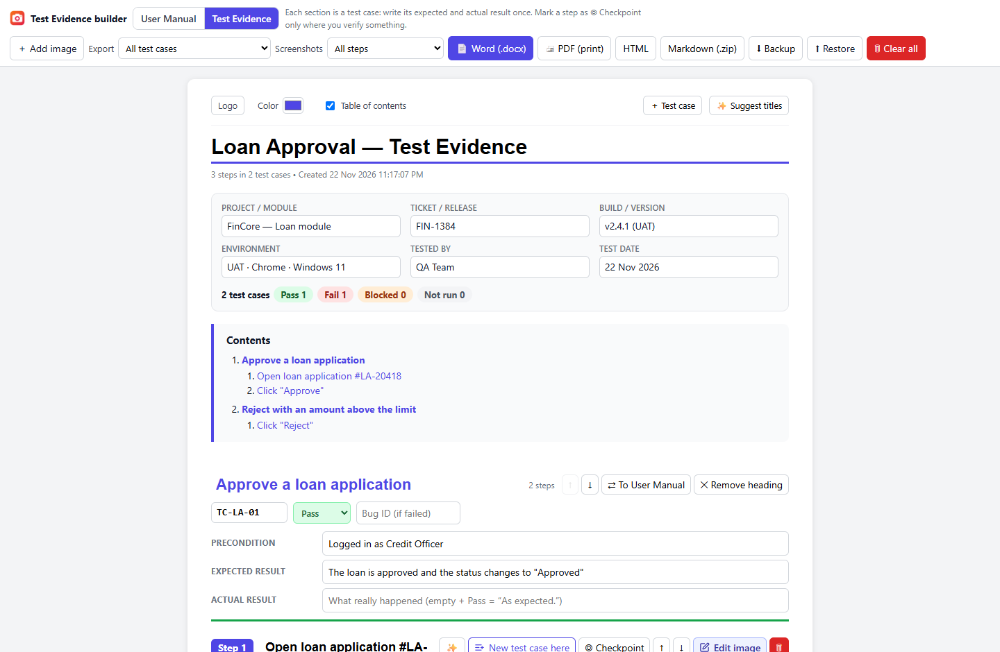
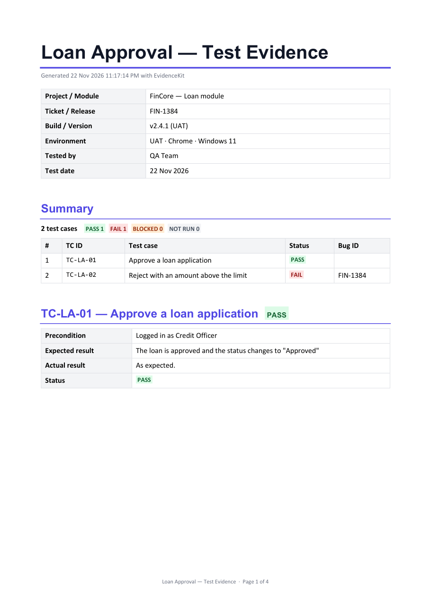
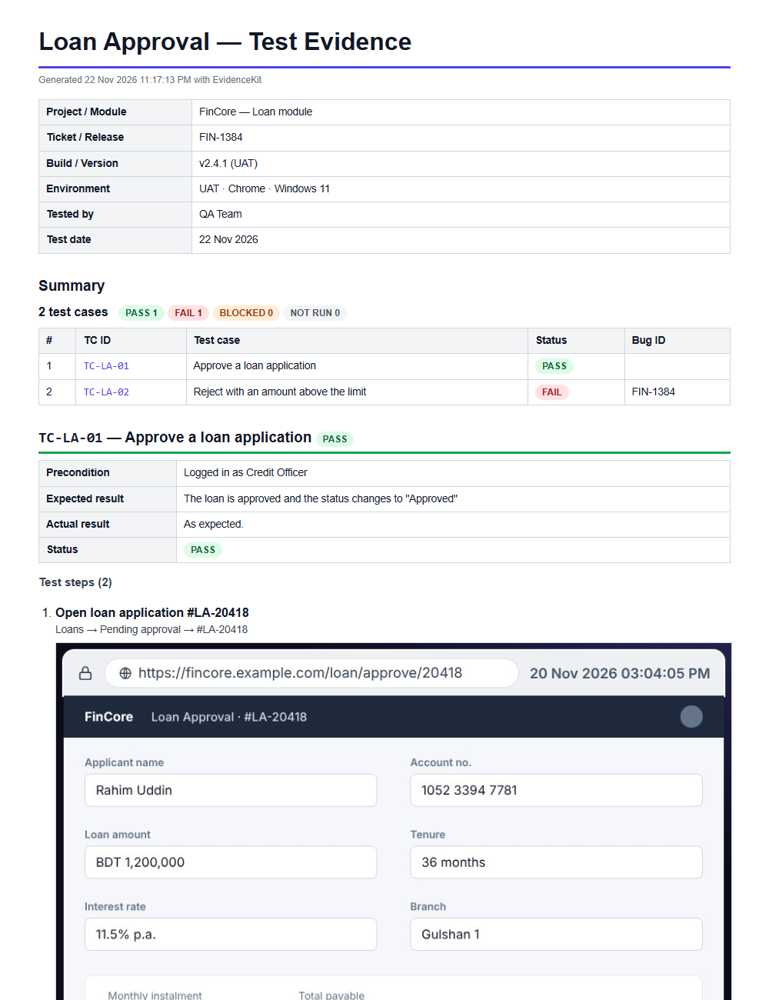

<div align="center">


# EvidenceKit

**The all-in-one evidence toolkit for QA engineers — right inside Chrome.**

Capture · Annotate · Record · Document


[**▶ Watch the video**](https://kaushikdebdas.github.io/EvidenceKit/) &nbsp;·&nbsp;
[**📖 User Manual**](docs/USER_MANUAL.md) &nbsp;·&nbsp;
[**⚡ Install**](#-install-in-1-minute)

<a href="https://kaushikdebdas.github.io/EvidenceKit/">
  
</a>

<sub>20-second preview · <a href="https://kaushikdebdas.github.io/EvidenceKit/">full video (1:25)</a> · <a href="docs/media/EvidenceKit-Promo.mp4">download the MP4</a></sub>

</div>

---

## Why EvidenceKit?

Bug reports and test evidence take too long: a screenshot here, the URL copied there, the console error pasted somewhere else, then everything put into a Word file by hand. EvidenceKit does all of it in one place:

- **Proof that holds up.** Every screenshot carries a browser-style bar with the page URL and the real date and time.
- **The error travels with the picture.** Console and network logs can be added under the screenshot.
- **Clicks become documentation.** Record a flow once and get a numbered step guide with a picture of every step.
- **Test evidence in minutes.** Test cases with expected / actual result, Pass / Fail and a summary table, exported as a real **Word (.docx)** file.
- **Private by design.** Nothing is uploaded. No account and no server: everything stays on your computer.

## What it does

<table>
<tr>
<td width="50%" valign="top">
<h3>📸 Capture</h3>
<p>Twelve capture modes: visible area, <b>full page</b>, area, element, <b>dual select</b>, <b>split view</b>, <b>scroll box</b>, <b>mobile view</b>, screen / app and delayed capture. Open menus and tooltips stay in the picture.</p>
</td>
<td width="50%" valign="top">
<h3>🕒 URL &amp; real time on every shot</h3>
<p>A browser-style bar with the page address and the date / time is stamped on the picture: your choice of format, size and position.</p>
</td>
</tr>
<tr>
<td width="50%" align="center"></td>
<td width="50%" align="center"></td>
</tr>
<tr>
<td width="50%" valign="top">
<h3>✏️ Annotate</h3>
<p>Arrows, boxes, numbered badges, <b>QA stamps</b> (PASS · FAIL · BUG · BLOCKED …), highlight, spotlight, magnifier, blur and redact, crop and a frame. Saves as PNG, JPG, WebP or PDF.</p>
</td>
<td width="50%" valign="top">
<h3>🐞 Console &amp; network in the picture</h3>
<p>Logs are recorded quietly in the background. Add the console and network panels to a screenshot, or export them as text, JSON or <b>HAR</b>.</p>
</td>
</tr>
<tr>
<td width="50%" align="center"></td>
<td width="50%" align="center"></td>
</tr>
<tr>
<td width="50%" valign="top">
<h3>🎬 Record · Trim · Share</h3>
<p>Record a tab, a window or the entire screen (up to 4K / 60 fps, MP4 or WebM) with sound, microphone and a camera bubble. Trim it, make a GIF, and get the <b>repro steps</b> with their time in the video.</p>
</td>
<td width="50%" valign="top">
<h3>👣 Every click becomes a step</h3>
<p>The <b>Step guide</b> turns each click and typed field into a step with a picture and a written title. Passwords are never written.</p>
</td>
</tr>
<tr>
<td width="50%" align="center"></td>
<td width="50%" align="center"></td>
</tr>
<tr>
<td colspan="2" valign="top">
<h3>📘 From clicks to a finished document: User Manual &amp; Test Evidence</h3>
<p>Two separate documents. Choose <b>＋ User Manual</b> or <b>＋ Test Evidence</b> whenever you add something (press both to add it to both).</p>
<ul>
<li><b>User Manual</b>: sections, auto-written step titles, your logo and brand colour, and a table of contents.</li>
<li><b>Test Evidence</b>: test cases with ID, precondition, <b>expected / actual result</b>, <b>Pass / Fail / Blocked</b>, bug ID, checkpoints and a summary.</li>
<li>Export to <b>Word (.docx)</b>, PDF, HTML or Markdown. <b>Backup &amp; restore</b> everything as one <code>.zip</code>.</li>
</ul>
</td>
</tr>
<tr>
<td colspan="2" align="center"></td>
</tr>
</table>

<details>
<summary><b>See an exported Test Evidence document</b></summary>
<br>

<table>
<tr><th width="50%">Word (.docx)</th><th width="50%">HTML</th></tr>
<tr>
<td width="50%" align="center" valign="top"></td>
<td width="50%" align="center" valign="top"></td>
</tr>
</table>

</details>

## ⚡ Install in 1 minute

> EvidenceKit is not in the Chrome Web Store yet. It is installed from this repository with Chrome's *Load unpacked*.

1. **Download**: click **Code → Download ZIP** at the top of this page and unzip it. Or clone it:
   ```bash
   git clone https://github.com/KaushikDebdas/EvidenceKit.git
   ```
2. **Developer mode**: open `chrome://extensions` (Edge: `edge://extensions`) and turn on **Developer mode**.
3. **Load unpacked**: click **Load unpacked** and choose the folder that contains `manifest.json`.
4. **Pin it**: click the puzzle icon in the toolbar and pin **EvidenceKit**.

> [!TIP]
> **Updating:** replace the files, then press **⟳ Reload** on the EvidenceKit card in `chrome://extensions`. Your screenshots, manuals and test evidence are kept.

## 🚀 Quick start

| I want to… | Do this |
|---|---|
| **Report a bug with proof** | Press <kbd>Alt</kbd>+<kbd>Shift</kbd>+<kbd>S</kbd> → mark the problem in the editor (box, arrow, **FAIL** stamp) → **Save** or **Copy**. Tick **Console / Network** in the popup first to put the errors in the picture. |
| **Record test evidence for a flow** | Press <kbd>Alt</kbd>+<kbd>Shift</kbd>+<kbd>G</kbd>, do the flow, press **Finish** → choose **＋ Test Evidence** → write the expected / actual result and set **Pass / Fail** → **Word (.docx)**. |
| **Write a user manual** | Record a Step guide or set *After capture → Add to Manual / Test Evidence* → choose **＋ User Manual** → add sections, titles and your logo → **Word (.docx)**. |
| **Record a video bug report** | Popup → **Record screen** → tick *Repro steps* → record → **Download**, make a **GIF**, or **Add to Test Evidence**. |

## ⌨️ Keyboard shortcuts

| Shortcut | Action |
|---|---|
| <kbd>Alt</kbd>+<kbd>Shift</kbd>+<kbd>S</kbd> | Capture the visible area |
| <kbd>Alt</kbd>+<kbd>Shift</kbd>+<kbd>A</kbd> | Select an area |
| <kbd>Alt</kbd>+<kbd>Shift</kbd>+<kbd>F</kbd> | Full page |
| <kbd>Alt</kbd>+<kbd>Shift</kbd>+<kbd>G</kbd> | Start / stop the Step guide |

More commands are waiting for a key at `chrome://extensions/shortcuts`: element, dual select, scroll box, split view, delayed capture, the screen recorder, and *add a recorder step* (that one can be *Global*).

## 🔒 Privacy

- **Nothing leaves your computer.** There is no account, no server, no analytics and no AI service. Step titles are written by simple rules on your computer.
- Screenshots stay in the browser for 24 hours (for *Last capture*). Saved files go to `Downloads/QA-Evidence/` or a folder you choose.
- Console and network logging can be switched off completely in **Settings → Logs**.

## 🧩 Requirements

- Chrome, Microsoft Edge or Brave, a recent version (Manifest V3).
- Windows, macOS or Linux. Word exports open in Microsoft Word, Google Docs and LibreOffice.

## 📁 Project structure

```text
EvidenceKit/
├── manifest.json          extension manifest (MV3)
├── background.js          service worker: captures, step guide, recorder steps, saving
├── content/               scripts injected into web pages (selection overlay, step guide, log hooks)
├── popup/                 toolbar popup
├── editor/                annotation editor (Fabric.js)
├── recorder/              screen recorder, repro steps, trim and GIF
├── manual/                User Manual & Test Evidence builder, Word / HTML / Markdown export, backup
├── options/               settings page
├── lib/                   shared code (IndexedDB, image composition, .docx writer, logs …)
├── icons/
└── docs/                  user manual, video and pictures for this page
```

## 📖 Documentation

- **[User Manual](docs/USER_MANUAL.md)**: every feature, step by step.
- **[Video](https://kaushikdebdas.github.io/EvidenceKit/)**: the 1:25 tour.

---

<div align="center">
<sub>EvidenceKit · made for QA engineers · your evidence stays on your computer</sub>
</div>
