

# EvidenceKit — User Manual

Screenshots with URL & time · annotation · console & network logs · screen recording · step guides · User Manuals · Test Evidence

[← Back to the project page](../README.md) &nbsp;·&nbsp; [▶ Watch the video](https://kaushikdebdas.github.io/EvidenceKit/)

---

## Contents

1. [Install and update](#1-install-and-update)
2. [The popup](#2-the-popup)
3. [Screenshots](#3-screenshots)
4. [The URL & time bar](#4-the-url--time-bar)
5. [After capture](#5-after-capture)
6. [Annotation editor](#6-annotation-editor)
7. [Console & network logs](#7-console--network-logs)
8. [Screen recorder](#8-screen-recorder)
9. [Step guide](#9-step-guide)
10. [User Manual & Test Evidence](#10-user-manual--test-evidence) · [Step pictures: numbers and editing](#step-pictures-numbers-and-editing)
11. [Test Evidence](#11-test-evidence)
12. [Exporting documents](#12-exporting-documents)
13. [Backup and restore](#13-backup-and-restore)
14. [Settings](#14-settings)
15. [Keyboard shortcuts](#15-keyboard-shortcuts)
16. [Storage and privacy](#16-storage-and-privacy)
17. [Troubleshooting](#17-troubleshooting)

---

## 1. Install and update

EvidenceKit works in **Chrome, Microsoft Edge and Brave**.

1. Download this repository (**Code → Download ZIP**, then unzip) or `git clone` it.
2. Open `chrome://extensions` (`edge://extensions` in Edge) and turn on **Developer mode** (top right).
3. Click **Load unpacked** and choose the folder that contains `manifest.json`.
4. Pin EvidenceKit: puzzle icon in the toolbar → pin.

**Updating:** replace the files with the new version, then press **⟳ Reload** on the EvidenceKit card in `chrome://extensions`.

> [!IMPORTANT]
> Always press **Reload** after replacing the files. If the files change while the browser is closed, Chrome keeps running the old background code until you reload the extension. Your data (screenshots, manuals, test evidence, settings) is kept; data from older versions is moved over automatically the first time.

> [!NOTE]
> Tabs that were already open before you installed or reloaded EvidenceKit need **one reload** before their console and network logs are recorded. The popup tells you when that is the case.

---

## 2. The popup

Click the EvidenceKit icon in the toolbar.

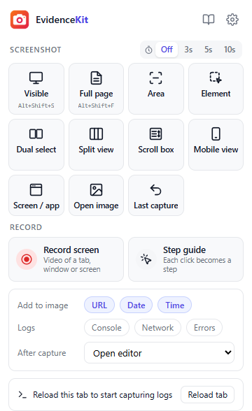

- **Screenshot**: the capture modes (see [3](#3-screenshots)). The small grey text under a tile is its keyboard shortcut.
- **Delay**: Off / 3 s / 5 s / 10 s. Open a menu or hover something while the countdown runs.
- **Record**: *Record screen* opens the [screen recorder](#8-screen-recorder); *Step guide* starts / stops the [step guide](#9-step-guide).
- **Add to image**: the URL, date and time on the picture.
- **Logs**: put the console and / or network panel under the screenshot, optionally errors only.
- **After capture**: what happens after each screenshot (see [5](#5-after-capture)).
- **📖 (book)**: opens the User Manual / Test Evidence page. A red **!** means a recorded step guide is waiting for you to choose where it goes.
- **⚙ (gear)**: Settings.
- The bottom line shows how many console messages and network requests were recorded for this tab.

 

---

## 3. Screenshots

| Mode | What it does |
|---|---|
| **Visible** | What you see now. |
| **Full page** | Scrolls and stitches the whole page (up to 16 000 px). On app-style pages where only an inner area scrolls (Outlook, Teams, Gmail …), that area is stretched to its full length with the header and sidebars kept in place. |
| **Area** | Drag a rectangle. The page is frozen first, so open dropdowns, tooltips and hover menus stay in the picture. The mouse wheel unfreezes it and scrolls. |
| **Element** | Hover a button, card or table and click it. <kbd>↑</kbd> / <kbd>↓</kbd> pick the parent / child element, <kbd>Enter</kbd> captures. Elements taller than the screen are captured in full. |
| **Dual select** | Select two areas; they are joined in one image (numbered 1 and 2). You can scroll between the first and the second area. |
| **Split view** | Tick 2–6 tabs from any window; they are captured one after the other and placed side by side, each with its own URL bar. |
| **Scroll box** | A list, table, chat or frame that scrolls (up/down, sideways or both) is scrolled and captured in full. Sticky header rows and frozen columns appear once. |
| **Mobile view** | The page at iPhone, Pixel, iPad, laptop or a custom size. The window is resized for a moment and put back. The layout is the real responsive layout; it is not a full phone emulation. |
| **Screen / app** | A screenshot of the whole desktop or of another program's window. |
| **Open image** | Annotate a picture from your computer or the clipboard. |
| **Last capture** | Reopens the latest screenshot in the editor (kept for 24 hours). |

Pages Chrome does not allow extensions to capture (`chrome://…`, the Chrome Web Store, the new-tab page) show a message instead.

---

## 4. The URL & time bar

Every screenshot, step-guide picture and recorder step picture can carry a browser-style bar with the page address and the **real** date and time.

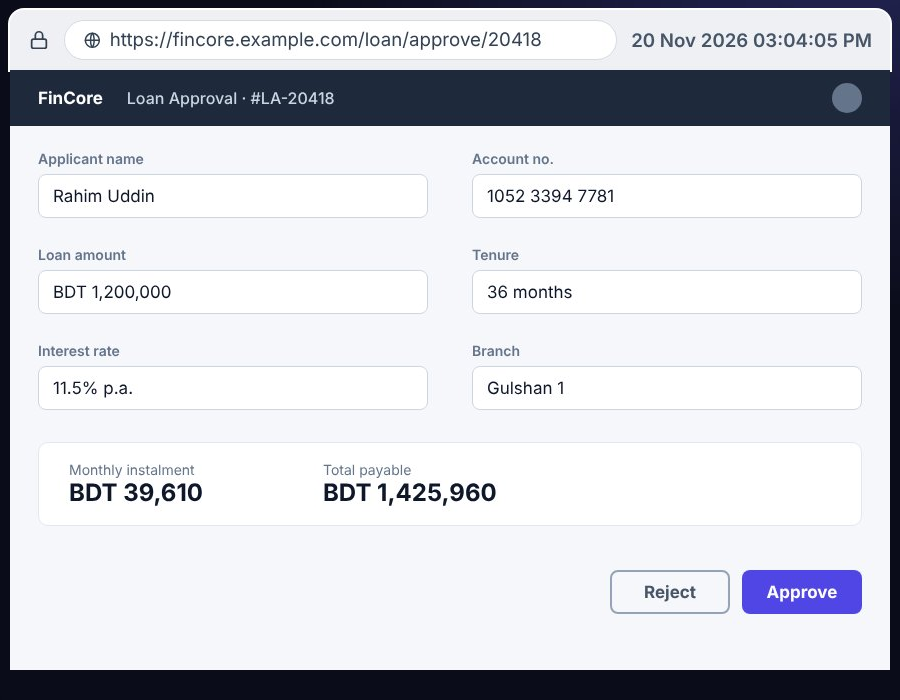

- Choose **URL**, **Date** and **Time** in the popup (*Add to image*), in Settings, or later in the editor (*URL & Time* panel).
- **Date format**: `2026-11-20`, `20-11-2026`, `20/11/2026`, `11/20/2026`, `20 Nov 2026` (default), `Nov 20, 2026`, or your own pattern.
  - Tokens: `DD` 05 · `D` 5 · `MM` 11 · `M` 11 · `MMM` Nov · `MMMM` November · `YYYY` 2026 · `YY` 26.
  - Text inside `[ ]` is kept as it is, e.g. `[Date:] DD/MM/YYYY`.
- 12-hour clock with AM/PM (default) or 24-hour.
- Bar position (top / bottom), style (dark / light) and size (S / M / L / XL).
- Pictures taken from another program (screen recordings) show the date and time only: there is no address to show.

---

## 5. After capture

Set in the popup or in Settings:

| Option | Result |
|---|---|
| **Open editor** (default) | The screenshot opens in the [annotation editor](#6-annotation-editor). |
| **Save + open editor** | Saved to your save folder and opened in the editor. |
| **Save to Downloads** | Saved straight away; a small message confirms it. |
| **Copy to clipboard** | Copied, ready to paste into Jira, Teams, Slack, mail … |
| **Copy + save** | Both. |
| **Add to Manual / Test Evidence** | A message on the page asks where it goes (see below). |

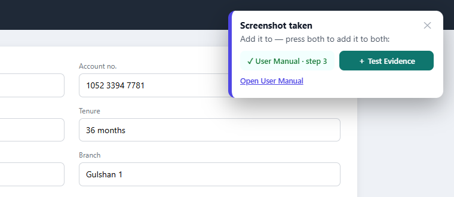

With **Add to Manual / Test Evidence**, press **＋ User Manual** or **＋ Test Evidence** in the message, or both to add it to both. Nothing is added until you press a button. After adding, **Open …** takes you to the document.

---

## 6. Annotation editor

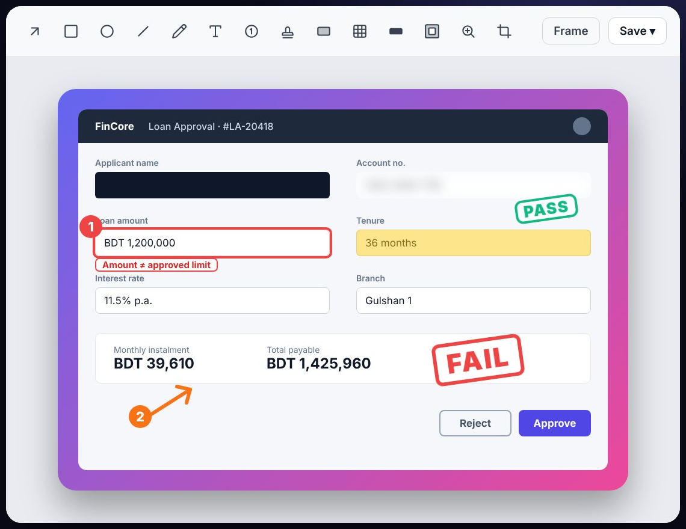

**Tools** (top bar; each has a one-letter key, press <kbd>?</kbd> to see them):
arrow, box, oval, line, pen, text (plain, white box, colour label or outline), **numbered badges**, **QA stamps**, highlight box, marker, spotlight, magnifier, **blur**, **redact**, eraser and crop.

- **Style**: colour swatches, eyedropper, size, dashed lines, fill and opacity.
- **QA stamps**: PASS · FAIL · BUG · BLOCKED · FIXED · NOTE · ✓ · ✗ · ? · ! or your own text. Change size, colour and text before or after placing; select a stamp and click another preset to swap it.
- **Numbered badges**: 1, 2, 3 … Delete one and the others close the gap; **↻ Renumber** at any time; double-click a badge to type another number.
- **Blur and redact**: blur pixelates; for passwords, tokens and personal data use **redact** (a solid black box), which cannot be undone in the saved picture.
- **Frame**: a gradient or solid background with padding, rounded corners and a shadow.
- **Panels** (buttons on the right): *URL & Time*, *Frame*, *Info* (URL, time, viewport, browser) and *Logs*.
- **Paste or drop** another image onto the screenshot.
- **Save**: PNG, JPG, WebP or PDF, with an editable file name, or **Copy**. <kbd>Ctrl</kbd>+<kbd>S</kbd> saves, <kbd>Ctrl</kbd>+<kbd>Shift</kbd>+<kbd>C</kbd> copies, <kbd>Ctrl</kbd>+<kbd>Z</kbd> / <kbd>Ctrl</kbd>+<kbd>Y</kbd> undo / redo, <kbd>?</kbd> shows every shortcut.
- **Add to Manual** / **Add to Test Evidence**: add the edited picture as the next step of either document (press both for both).
- **Theme**: light by default; dark with the moon button.

---

## 7. Console & network logs

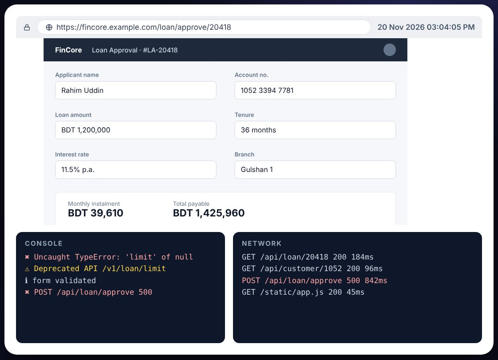

EvidenceKit records each tab's console messages (log, info, warn, error, uncaught errors, rejected promises) and network requests (fetch, XHR, scripts, styles, images …) in the background.

- Tick **Console** and / or **Network** in the popup before capturing to add the panels under the picture; **Errors** keeps only errors, warnings and failed requests.
- In the editor, the **Logs** panel lists everything. Search it, and export it as **text**, **JSON** or **HAR** (opens in Chrome DevTools, Fiddler, Charles …).
- **Settings → Logs**: switch recording off completely (then no script runs in web pages), keep logs across page loads, and set the number of lines in the picture.

---

## 8. Screen recorder

Popup → **Record screen**.

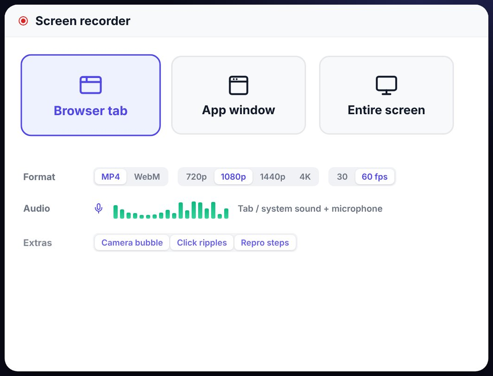

- **What to record**: a browser tab, an app window, or the entire screen.
- **Format & quality**: MP4 or WebM · 720p, 1080p, 1440p or 4K · 30 or 60 fps.
- **Audio**: tab / system sound and a microphone (with a level meter; mute while recording).
- **Extras**: camera bubble, click ripples, countdown, pause / resume.
- **Floating controls**: a small always-on-top window with the timer, 📸, pause and stop. It stays visible over other programs.

### Repro steps

Tick **Repro steps** and every click and typed field becomes a step with its time in the video. Typed values are optional, and passwords are never written.

| You record… | Steps come from |
|---|---|
| **A tab** | Clicks and typing in the tab you started from. Step pictures come from that tab. |
| **The entire screen or a window** | Clicks and typing in **any Chrome tab** · **opening or switching tabs** (e.g. a PDF report opening in a new tab) · **switching to another program** (Excel, Edge …) and back. Step pictures are taken **from the screen video**, so they show what was really on screen, other programs included. On an entire-screen recording, the click is outlined in the picture. |

> [!NOTE]
> A browser extension cannot see clicks *inside* other programs such as Excel or Edge; the operating system does not allow it. While another program is in front, a big change of the screen that then stays still becomes a step (*The screen changed*). You can also take a step yourself at any moment:
> - **📸 Add step now** in the recorder window or in the floating controls, or
> - the shortcut *Screen recorder: add a step now*: set it at `chrome://extensions/shortcuts` and choose **Global** so it works in any program.

### After recording

- Preview, rename and **Download** the video (also automatically, if *Save automatically* is on).
- **Trim** it, export an animated **GIF** (up to 30 s, 800 px, 10 fps), or open the current **Frame** in the editor.
- **Repro steps**: jump to a step's time, remove steps, **Copy** them as text, **Download** them (Markdown, or a ZIP with the pictures), or **Add to Manual** / **Add to Test Evidence**.

> [!TIP]
> Trim, GIF and Frame need the browser to decode the recording. If Chrome cannot decode one of its own MP4 files you will see a message (the file still downloads). Choose **WebM** if you trim or make GIFs often.

---

## 9. Step guide

Popup → **Step guide**, or <kbd>Alt</kbd>+<kbd>Shift</kbd>+<kbd>G</kbd>.

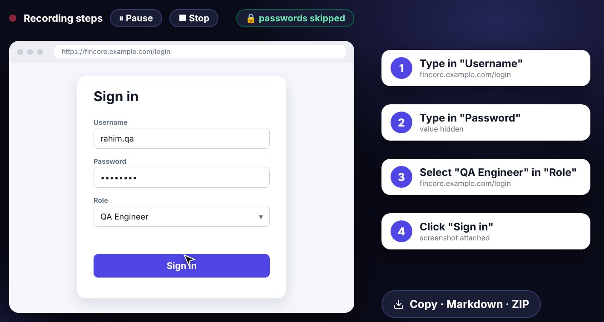

- Every click and typed field becomes a step with a screenshot, the clicked element outlined and numbered, the URL & time bar, and a written title such as *Click "Save"* or *Type in "Email"*.
- A small panel on the page shows the count and has **Pause** and **Finish**.
- The guide follows the tab across page loads. Typed values are written only if you allow it in Settings; passwords never are.

When you press **Finish**, the User Manual page opens and asks where the recording goes:

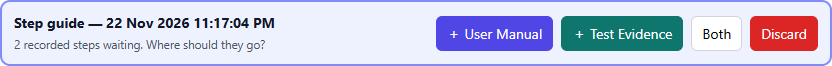

**＋ User Manual**, **＋ Test Evidence**, **Both** or **Discard**. In the Test Evidence the recording becomes a test case. If you closed the tab instead, the recording still waits there (the popup's book icon shows a red **!**).

---

## 10. User Manual & Test Evidence

The 📖 page holds **two separate documents**. The switch at the top chooses which one you see:

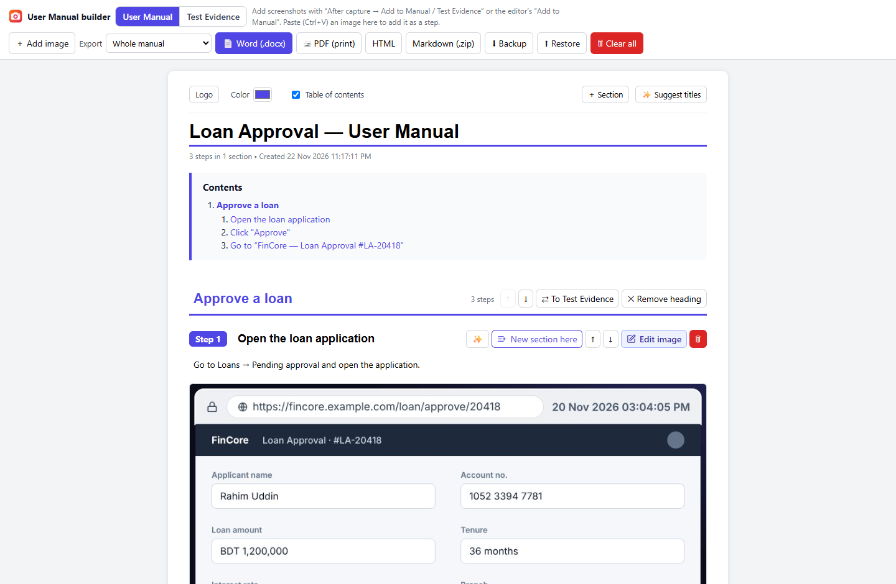

- **User Manual**: step-by-step instructions for the people who use the application.
- **Test Evidence**: test cases with results (see [11](#11-test-evidence)).

**Adding steps.** You always choose the document when you add something: the after-capture message, a finished step guide, the recorder's repro steps and the editor all have **＋ User Manual** and **＋ Test Evidence** (press both to add to both). You can also **＋ Add image** from your computer or paste one with <kbd>Ctrl</kbd>+<kbd>V</kbd>.

**Working with steps**

- **Sections** split a document into flows such as *Registration* and *Login*: **New section here** on the first step of a flow, or **＋ Section** at the end. Step numbers start again at 1 in every section.
- **↑ / ↓** move steps and headings; moving a step across a heading changes its section. **Remove heading** keeps its steps.
- **⇄ To Test Evidence / To User Manual** moves a whole section with its steps to the other document.
- **✨** suggests a title and description from what was clicked or captured (simple rules on your computer, no AI).
- **Edit image** (or double-click the picture) opens the editor inside the page; see [Step pictures: numbers and editing](#step-pictures-numbers-and-editing) below.
- **Branding**: your logo, a brand colour and a table of contents, also in every export.
- **Clear all** empties only the document you are looking at.

**Messages and new steps**

- Saving, copying or adding something (in the popup, the editor and the screen recorder) shows a large green message with a title and, where it fits, an **Open …** button. It closes by itself after 3 seconds, or press ✕.
- When you come back to this page, steps added meanwhile glow green with a **NEW** tag for a few seconds, and the page scrolls to them.

### Step pictures: numbers and editing

**Numbers follow the steps.** Pictures from the Step guide and from the recorder's repro steps keep a clean copy of the screenshot and remember where the click was. When you delete, move or split steps, the number drawn on each picture is redrawn to match the *Step* number shown on the page, and the exports (Word, PDF, HTML, Markdown) use the same numbers.

- This applies to steps whose clicked element is outlined with a box and a number. Steps marked only with a circle (a click on a large area) carry no number.
- Steps made with an older version of EvidenceKit, before pictures kept a clean copy, keep the number they have. Record them again to get automatic numbering.

**Annotations stay editable.** **Save to step** keeps your arrows, boxes, stamps, badges and text as separate layers, not burnt into the picture. Press **Edit image** again later and everything can still be moved, changed or deleted.

**The click marker is editable too.** In the editor, the click outline and its number badge are ordinary objects: move, resize or delete them like anything else.

- The badge's number keeps following the *Step* number automatically.
- **Double-click** the badge to type another number; from then on that number stays as you typed it.

**Your own numbered badges** (the badge tool) are numbered 1, 2, 3 … Delete one and the others close the gap; **↻ Renumber** in the badge options sorts them again at any time; double-click a badge to type another number.

**Frame:** a step saved with the **Frame** option on (background, padding, shadow) keeps its number as it was, because the frame is part of the saved picture.

---

## 11. Test Evidence

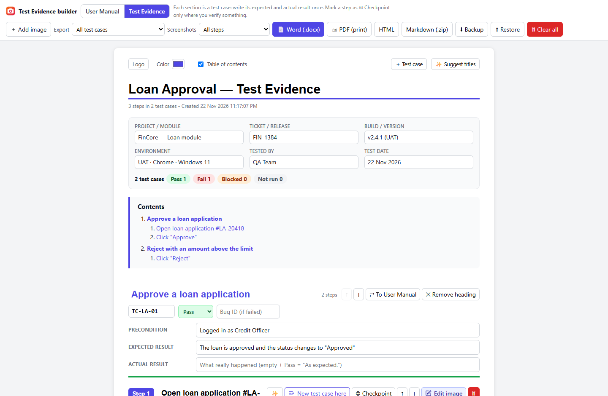

At the top, fill in the **project / module, ticket / release, build, environment, tester and test date**. The summary below counts the passed, failed, blocked and not-run test cases.

Every section is a **test case** with:

| Field | Notes |
|---|---|
| **ID** | Leave it empty for TC-01, TC-02 … or type your own (e.g. `TC-LA-01`). |
| **Status** | Not run · Pass · Fail · Blocked. |
| **Bug ID** | For failed test cases. |
| **Precondition** | e.g. *Logged in as Credit Officer*. |
| **Expected result** | What should happen. |
| **Actual result** | What really happened. Leave it empty on a passed test case and the export says *As expected.* |

**You write the result once per test case, not for every click.** A recorded flow (log in, open the form, fill it in, save …) gives many steps; they are simply listed as the test steps.

**◎ Checkpoint**: mark a step where you verify something (e.g. *"Asset saved" appears*). Only that step gets its own expected / actual result and Pass / Fail.

**Screenshots in the export**: *All steps*, *Checkpoints + last step* (one picture per test case unless you marked checkpoints, which keeps long flows short) or *None*.

---

## 12. Exporting documents

Choose **Whole manual** / **All test cases** or a single section / test case in *Export*, then:

| Button | Result |
|---|---|
| **📄 Word (.docx)**, the main export | A real Word document: A4, pictures inside, page numbers, your logo. Opens in Word, Google Docs and LibreOffice. |
| **🖨 PDF (print)** | The browser's print dialog: choose *Save as PDF*. |
| **HTML** | One file with the pictures inside; opens in any browser. |
| **Markdown (.zip)** | `.md` file + an `images/` folder, for wikis and Git repositories. |

A Test Evidence export starts with the project details and a **summary table** (TC ID · test case · status · bug ID), followed by every test case with its result table, test steps and pictures:

| Word | HTML |
|---|---|
| 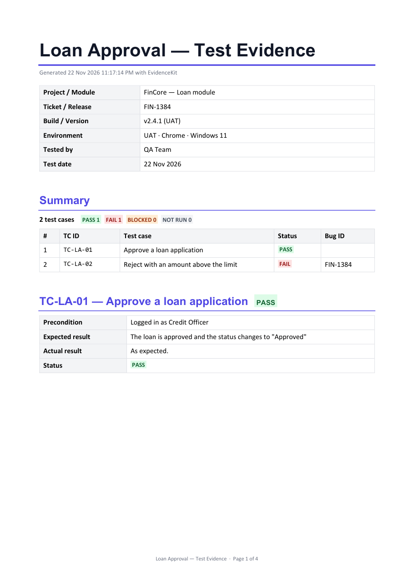 | 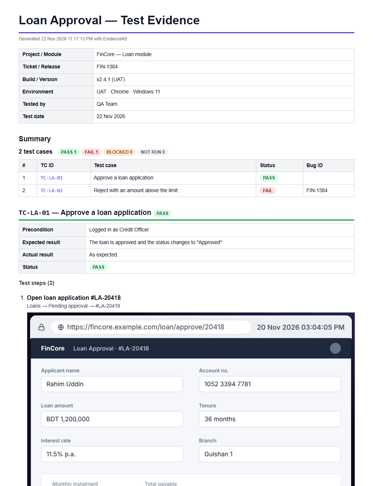 |

---

## 13. Backup and restore

On the 📖 page:

- **⬇ Backup** saves **both documents** into one `.zip`: every step and section with all pictures, results, titles, logo, colour, evidence details and your settings.
- **⬆ Restore** loads such a file, on this or another computer:
  - **Replace everything**: the backup takes the place of both documents.
  - **Add to what I have**: the backup's steps go after the current ones, each into its own document.
  - Tick *Also restore the extension settings* to take the settings too.

Screenshots kept for 24 hours (*Last capture*) are not part of a backup. A save folder chosen in Settings must be chosen again on another computer.

> [!TIP]
> Make a backup now and then, and before uninstalling the extension or clearing the browser's site data: the documents live inside the browser.

---

## 14. Settings

Popup → ⚙, or right-click the icon → *Options*.

- **Stamp**: URL, date / time, formats, position, style and size, with a live preview.
- **Saving**: image format (PNG / JPG and quality), file-name pattern (`{host}`, `{title}`, `{date}`, `{time}`), *Ask where to save*, and the save location:
  - **Downloads folder** (`Downloads/QA-Evidence/` by default), or
  - **A folder I choose** on your computer. If Chrome asks for permission again after a restart, files go to Downloads until you press *Allow access again*. Brave does not allow picking folders.
- **Capture**: freeze the page for area selection, delay, dual-select layout.
- **Logs**: automatic recording on/off, keep logs across page loads, errors only, number of lines.
- **Editor**: default colour, line width, text and badge size; light / dark theme.
- **Step guide**: marker colour, record typing, write typed values, first step = "open the page".
- **Screen recorder**: format, quality, frame rate, countdown, sound, click ripples, automatic saving, repro steps, step pictures, typed values.
- **Shortcuts & data**: change keyboard shortcuts, **delete temporary screenshots now**, see how much space EvidenceKit uses, delete all steps, reset settings.

---

## 15. Keyboard shortcuts

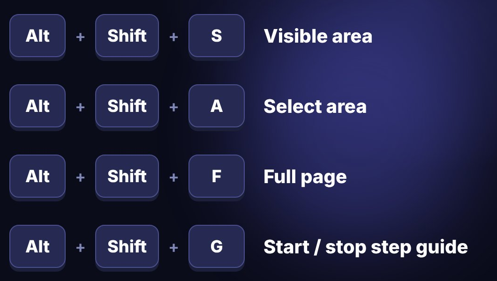

| Shortcut | Action |
|---|---|
| <kbd>Alt</kbd>+<kbd>Shift</kbd>+<kbd>S</kbd> | Capture the visible area |
| <kbd>Alt</kbd>+<kbd>Shift</kbd>+<kbd>A</kbd> | Select an area |
| <kbd>Alt</kbd>+<kbd>Shift</kbd>+<kbd>F</kbd> | Full page |
| <kbd>Alt</kbd>+<kbd>Shift</kbd>+<kbd>G</kbd> | Start / stop the Step guide |

Without a default key (Chrome allows only four): element, dual select, scroll box, split view, delayed capture, open the screen recorder, and *Screen recorder: add a step now*. Give them keys at `chrome://extensions/shortcuts`.

---

## 16. Storage and privacy

- **Everything stays on your computer.** No account, no server, no analytics, no AI service.
- **Documents** (User Manual, Test Evidence) and **settings** are stored inside the browser. Use [Backup](#13-backup-and-restore) to keep a copy.
- **Screenshots for *Last capture*** are kept for 24 hours and cleaned up automatically. *Settings → Shortcuts & data → Delete temporary screenshots now* removes them at once.
- **Saved files** go to `Downloads/QA-Evidence/` or the folder you chose.
- **Logs**: a small script in each web page records console messages and network requests for that tab only. They are kept for the current browser session and removed when the tab is closed or the browser restarts. Turn it off in *Settings → Logs* and the script no longer runs in any page.
- **Typed values** are only written into step titles if you allow it; **passwords never are**.

---

## 17. Troubleshooting

<b>"Reload this tab to start capturing logs"</b>

The tab was open before EvidenceKit was installed or reloaded. Press **Reload tab** in the popup (or <kbd>F5</kbd>).

<b>"Chrome does not allow capturing this page"</b>

Browser pages (`chrome://…`, `edge://…`), the new-tab page and the Chrome Web Store cannot be captured by any extension. Use **Screen / app** for those.

<b>After an update something behaves like the old version</b>

Open `chrome://extensions` and press **⟳ Reload** on EvidenceKit, then reload the tabs you use.

<b>Files go to Downloads instead of my chosen folder</b>

Chrome asks for permission again after a restart. Open **Settings → Saving** and press **Allow access again**. In Brave, choosing a folder is not available.

<b>Clicks in Excel / Edge / another program are not steps</b>

A browser extension cannot see clicks inside other programs. Record the **entire screen**. Switching programs and big screen changes become steps automatically. Press **📸 Add step now** (recorder or floating controls) or your *Global* shortcut for anything else.

<b>Trim / GIF / Frame are greyed out after recording an MP4</b>

Chrome could not decode that MP4 file (it still downloads fine). Choose **WebM** under *Quality & options* for recordings you want to trim or turn into a GIF.

<b>Where are my documents? Can I move them to another computer?</b>

They are stored inside the browser profile. Use **⬇ Backup** on the 📖 page and **⬆ Restore** on the other computer.

---

<a href="../README.md">← Back to the project page</a> · EvidenceKit

